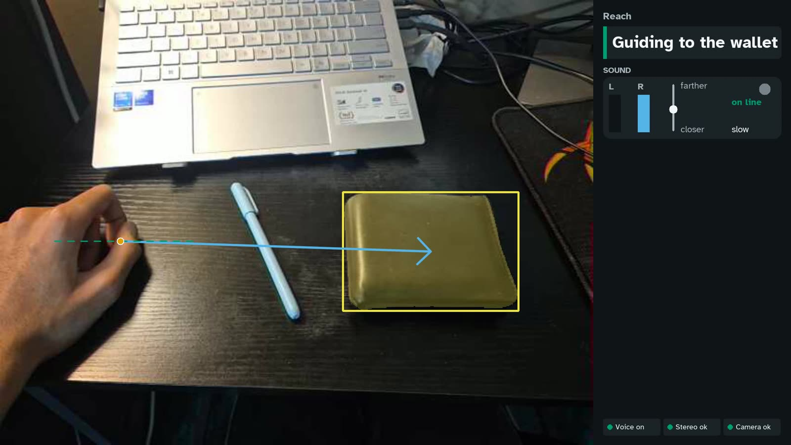
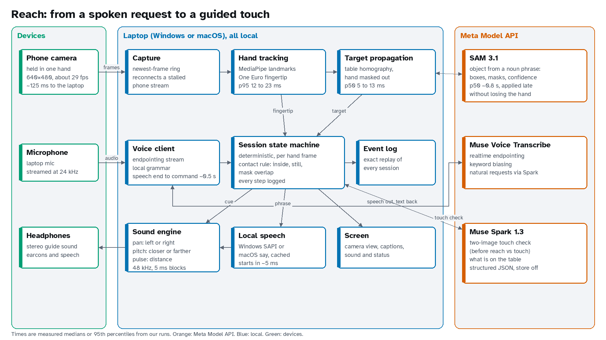

# Reach

**Say what you're looking for, and sound guides your hand to it.**

Reach helps blind and low-vision people find an object on a table. You hold your
phone over the table and say "find the wallet". Meta's SAM 3.1 finds the wallet in
the camera view, your hand is tracked on the laptop, and stereo sound steers your
fingers toward it: left or right in your ears, pitch for closer or farther, pulses
that speed up as you get near. When you touch it, a chime plays and Muse Spark checks
that it is the object you asked for.

**Demo video:** _link added at submission_



Built for the Meta Global AI Developer Hackathon, Oct 27 to Nov 4, 2026, by
Varun Bhandari and Chaitanya Manik.

## Why

Finding something you just put down is a small task that repeats all day. Without
sight it usually means sweeping your hands across the table and knocking things
over. Existing apps can describe a scene or help aim the phone at an object; Reach
closes the last half metre by guiding the hand itself, and tells you what you
touched.

## How it works



1. **You ask.** The microphone streams to **Muse Voice Transcribe** (realtime,
   with endpointing and keyword biasing). A local grammar turns "find the wallet",
   "what's on the table", "stop", "louder" or "help" into a command in about half a
   second after you stop speaking. Requests it doesn't recognise but that sound like a
   request, in any language, go to **Muse Spark** as text and come back as a
   structured command.
2. **SAM 3.1 finds it.** A camera frame and the noun phrase go to **SAM 3.1**,
   which returns every match with a box, a mask and a confidence. Between results,
   Reach carries the target along by tracking the table itself, with the hand masked
   out, so the lock survives your hand covering the object and late results are
   applied to the current frame in under a millisecond.
3. **Your hand is tracked locally.** MediaPipe finds the hand on every frame; a
   filtered fingertip with a little prediction drives the sound.
4. **Sound guides you.**

   | You hear | It means |
   |---|---|
   | The tone moves left or right | the object is to that side |
   | Higher pitch / lower pitch | farther from you / closer to you |
   | Faster pulses | you are getting close |
   | A soft hiss | your hand is level with the object |
   | Two rising notes, two falling notes | target found / target lost |
   | A chord | you are touching it |

   The sound is synthesised in 5 ms blocks, and Reach's spoken phrases are mixed
   into the same stereo stream, so the guide ducks while it speaks.
5. **Contact, then a check.** Contact fires when the fingertip is inside the target,
   nearly still relative to it, and the hand covers part of its mask for three
   frames. Then **Muse Spark** compares a picture of the object from before your hand
   arrived with the moment of touch and answers in strict JSON: same object or not.
   A wrong object is excluded and guidance resumes.
6. **Everything replays.** One deterministic state machine makes every decision,
   and each step logs its inputs and outputs. `reach replay` rebuilds a whole
   session from its log, with no camera, models or network, and checks that every
   decision matches.

More: two of the same object are told apart by "left" or "right"; "what's on the
table" lists what Muse Spark sees; requests for sharp or hot things are refused;
Hindi works on macOS; a high-contrast view helps low-vision users; and the phone
stream reconnects by itself if Wi-Fi stalls.

## How Reach uses Meta's models

- **SAM 3.1** is the perception layer of a closed control loop, not a one-off
  detector: open-vocabulary phrases ("blue pen", "mug"), masks used for the contact
  test, confidence and instance lists used to ask "left or right", and results
  re-seeded into a local table tracker so a 0.8 s cloud call never stalls 30 Hz
  guidance.
- **Muse Voice Transcribe** runs as one continuous endpointing session with keyword
  biasing for object and command words; "stop" acts on the partial transcript
  without waiting for the end of the turn.
- **Muse Spark 1.3** does three jobs with structured output: a two-image identity
  check at touch time (before vs after the reach), a list of objects on the table,
  and turning free-form or non-English requests into commands. All requests use the
  standard tier with `store: false`.

What we tried and dropped: using SAM to find the hand as well (one concept per
request doubled the cost and latency, so MediaPipe tracks the hand locally);
appearance trackers such as KCF and CSRT for the target (they follow the hand when
it covers the object); and a single-image touch check (it called a pen a "stylus";
the two-image comparison had no false rejections on 60 saved correct pairs).

## Results

| | Windows, Android phone | Mac, iPhone |
|---|---|---|
| Spoken commands understood | 20/20 | 20/20 |
| End of speech to command, median | 531 ms | 515 ms |
| Sighted touches with a correct chime | 10/10 | 10/10 |
| Eyes-covered touches within 45 s | 5/5 (two objects) | not completed |
| Touch check on saved pairs: same / different object | 30/30 / 15/15 | 30/30 / 15/15 |
| 10-minute sessions without an audio dropout | yes | yes |

Full tables, latency per stage and what went wrong: [RESULTS.md](RESULTS.md).

## Limitations

The only testers were the two of us, sighted, with our eyes covered, which shows
the loop works with a person in it but not that it suits blind users; that testing
is the next step. Guidance is in the image plane of a hand-held phone, so it has no
true depth and assumes the phone is held roughly level over the table. Cloud
latency varies (Muse Spark took 1.4 to 5.6 s), and the Mac setup used Bluetooth
headphones, which add about 165 ms. Details: [EVALUATION.md](EVALUATION.md).

## Run it

Requires Python 3.12 with [uv](https://docs.astral.sh/uv/), Windows or macOS,
a phone camera (an Android phone running IP Webcam, or an iPhone through Continuity
Camera), wired or stereo headphones, and a Meta Model API key.

```
uv sync
copy .env.example .env      # add your MODEL_API_KEY (cp on macOS)
uv run reach setup          # choose camera, stereo output and microphone
uv run reach start          # hold the phone over the table and say "find the ..."
```

Download the [MediaPipe hand model](https://storage.googleapis.com/mediapipe-models/hand_landmarker/hand_landmarker/float16/1/hand_landmarker.task)
to `models/hand_landmarker.task` first. Without any devices or network you can
still replay the included session and render sample screens:

```
uv run reach replay sample_trial
uv run reach ui-preview --out runs/ui-preview
uv run pytest
```

Every option, key and component interface is in [docs/development.md](docs/development.md).

## Built during the hackathon

All code in this repository was written between Oct 27 and Nov 4, 2026; the first
commit is dated Oct 27. Pre-existing libraries and assets we use: MediaPipe and its
hand landmarker model, OpenCV, NumPy, sounddevice (PortAudio), websockets, the
OpenAI Python SDK (pointed at the Meta Model API), meta-sam-parser, Pillow, PyYAML,
python-dotenv, comtypes and pyttsx3 on Windows, the operating systems' built-in
speech voices, and the Atkinson Hyperlegible and Noto Sans Devanagari fonts.

## Scope and privacy

Reach is a hackathon prototype, not a medical device and not a mobility aid. It is
only for finding non-hazardous objects on a tabletop within arm's reach, and its
answers can be wrong; always confirm by touch. Camera frames go only to the Meta
Model API standard tier, which does not use them for training; microphone audio is
streamed for transcription and not saved; logs stay on your computer. See
[EVALUATION.md](EVALUATION.md) for the full statements.

## Credits

Varun Bhandari and Chaitanya Manik. Fonts: Atkinson Hyperlegible (Braille
Institute) and Noto Sans Devanagari, both under the SIL Open Font License 1.1; the
licence files are in `src/reach/assets/fonts/`. The demo video's narration uses an
ElevenLabs AI voice.

## License

Apache-2.0. See [LICENSE](LICENSE).
